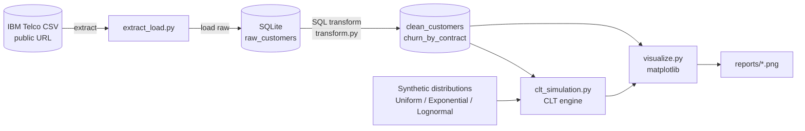
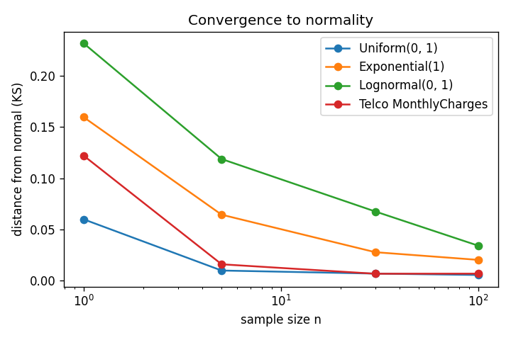
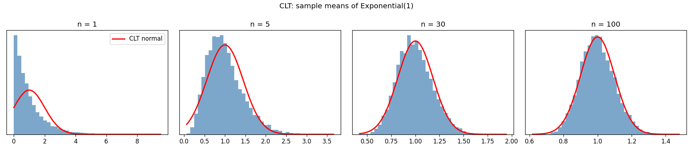
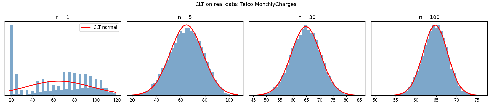
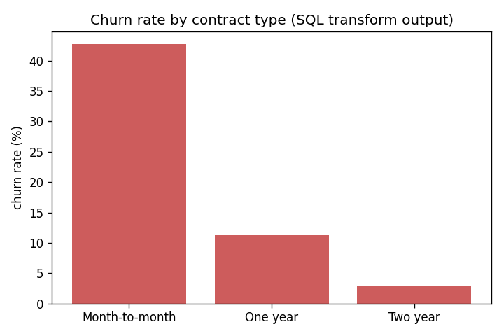

# Telco Churn ELT Pipeline + Central Limit Theorem Simulator

A small, end-to-end Python project that:

1. **Extracts** the public IBM Telco Customer Churn dataset (7,043 customers),
2. **Loads** it untouched into a SQLite database,
3. **Transforms** it with SQL (cleaning + churn-by-contract summary), and
4. **Simulates** the **Central Limit Theorem (CLT)** on synthetic distributions *and* on the real `MonthlyCharges` data, then charts the results.

## Pipeline diagram



`pipeline.py` runs every step in order.

## The math: Central Limit Theorem

For independent samples with mean μ and standard deviation σ, the average of
n samples is approximately **Normal(μ, σ/√n)** as n grows — *even if the
original data is not normal*.

The engine ([clt_simulation.py](clt_simulation.py)):

1. Draws 10,000 samples of size n (n = 1, 5, 30, 100) from a distribution.
2. Takes the mean of each sample.
3. Compares those means with the normal curve the CLT predicts (red line), and
   measures the gap with a Kolmogorov–Smirnov (KS) distance. Smaller = more normal.

For real data it resamples (bootstrap) from the observed `MonthlyCharges`.

## Results

Simulated standard error matches theory σ/√n (Exponential(1), n = 100: theory 0.100, simulated 0.100),
and the distance from normal shrinks as n grows.

| Starting distribution | KS distance, n=1 | n=100 |
|---|---|---|
| Uniform(0,1) | 0.060 | 0.005 |
| Exponential(1) | 0.160 | 0.020 |
| Lognormal(0,1) (heavy skew) | 0.232 | 0.034 |

Heavier skew needs larger n — a nice, intuitive takeaway.






Other charts in [reports/](reports/): `source_distributions`, `clt_uniform`, `clt_lognormal`.

## Run it

```bash
pip install -r requirements.txt
python pipeline.py
```

## Project layout

| File | Role |
|---|---|
| `config.py` | paths and source URL |
| `extract_load.py` | download CSV, load to SQLite |
| `transform.py` | SQL cleaning + aggregation |
| `clt_simulation.py` | CLT simulation engine |
| `visualize.py` | charts |
| `pipeline.py` | runs everything |
